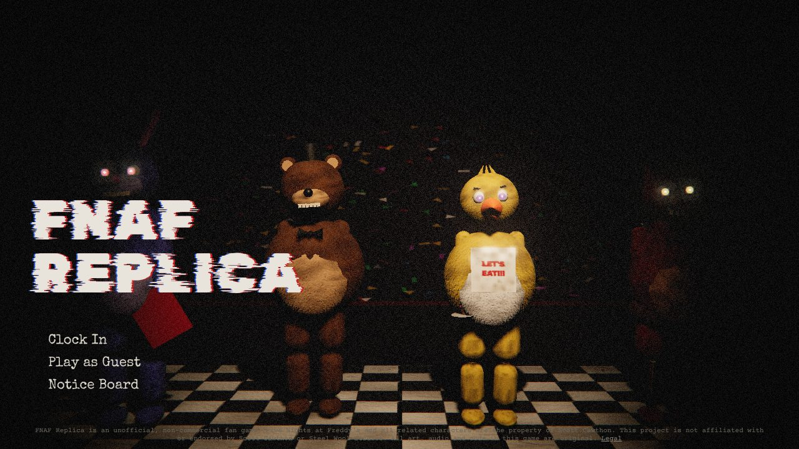
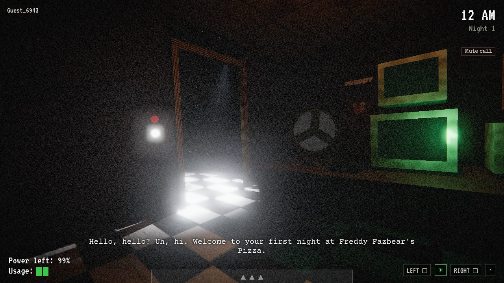
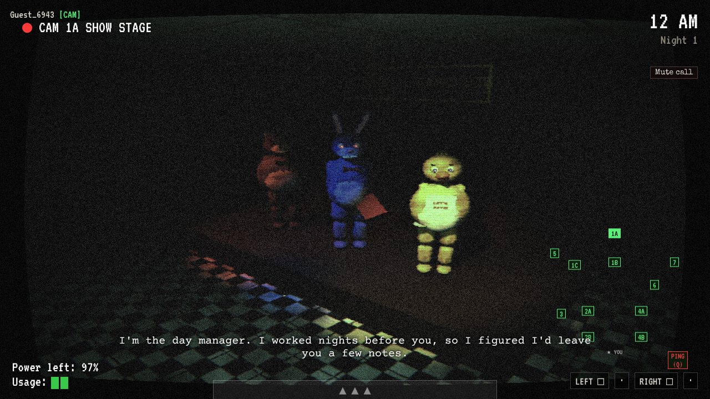

# FNAF Replica

Four night guards, one haunted pizzeria, one shared power supply. FNAF Replica takes the 2014 formula
(doors, lights, cameras, a power meter that never stops falling, animatronics that move when you look
away) and splits it across up to four players over the internet. Each guard holds a different station
with a different tool, everyone drains the same building, and you talk over a crackly push-to-talk radio
to decide who watches what. Survive until 6 AM with at least one guard alive and the whole crew gets paid.
Solo? Classic Office plays like the original, down to the AI and power tables.

**Live:** https://fnaf-replica-production.up.railway.app





> FNAF Replica is an unofficial, non-commercial fan game. Five Nights at Freddy's and all related
> characters are the property of Scott Cawthon. This project is not affiliated with or endorsed by Scott
> Cawthon or Steel Wool Studios. All art, audio and code in this game are original.

## How to play

Sign up (or play as a guest and claim the account later), pick **Clock In**, then make or join a lobby.
Share the four-letter room code, pick stations, ready up. The host picks the night.

| Station | Doors | Tool |
|---|---|---|
| West Office | West door + light | Flashlight down the West Hall: sends the fox back if you catch him early |
| East Office | East door + light | Kitchen Mic: hear the kitchen and footsteps with direction |
| South Office | Two doors, two lights | Mask: fools some visitors (not the fox) |
| Control Room | Vent shutter + vent light | Maintenance panel: reboots, power boost, audio lures, the music box |

Fewer than four guards? Unused stations are sealed. One guard gets a merged Solo Station.

| Action | Default keys |
|---|---|
| Look left / right | A / D, arrows, or move the mouse to the screen edge |
| Tablet up / down | Space, S, right-click, or hover the bar at the bottom |
| Left door / right door | Q / E (South: south-left / south-right; Control: E is the vent) |
| Hold left / right light | Z / C, or hold the wall button |
| Station tool | F (flashlight is held, mic toggles) |
| Mask (South) | M |
| Maintenance panel (Control) | Tab |
| Wind the music box | W (Control, or anyone on CAM 08) |
| Switch camera | 1 to 0, or click the map |
| Ping the camera you're on | Q while on the tablet |
| Push to talk | V |
| Chat / callout wheel | Enter / G |
| Settings and leave | Esc (the night never pauses) |

On a phone or tablet the game shows touch controls instead: drag across the office to look, tap Door, hold
Light, tap Cams, and in free roam a floating joystick under the left thumb with drag-to-look on the right. They
switch on by themselves for touch screens; Settings > Accessibility > Touch controls (or `?touch=1`) forces them.
Turn the phone sideways.

Every binding can be changed in the Notice Board. Accessibility: reduced jump scares, photosensitivity
mode, subtitles, visual sound cues, colourblind button labels, hold-or-toggle lights, hide gore.

Modes: **Night Shift** (co-op, Nights 1 to 6 and Custom Night), **Classic Office** (solo, FNAF 1 rules),
**Showtime** (one player is the Puppeteer and moves the animatronics on a top-down map).

## Run it locally

You need Node 20 and Postgres 16.

```bash
docker run -d --name fnaf-pg -e POSTGRES_PASSWORD=postgres -e POSTGRES_DB=fnaf -p 5432:5432 postgres:16
cp .env.example .env          # then set SESSION_SECRET
npm install
npm run db:migrate            # the server also migrates on boot
npm run dev                   # Vite on :5173 with a proxy to the server on :3000
```

`FAST_NIGHT=1` makes each in-game hour five seconds. `?perf=low` on the URL forces the low preset.
On localhost, `?gallery=stage` (any node, or `office:west&light=west&yaw=0.8`) renders one scene, and
F9 in a night toggles the node-graph debug overlay.

Production build: `npm run build && npm start` (serves `client/dist` from the Fastify server).

## Deployment

`main` on GitHub → Railway project **arcade** (the Open Arcade project) → service `fnaf-replica`, with a
Railway PostgreSQL database in the same project. Railway builds with Nixpacks on every push and checks
`/healthz`. Details and click-by-click setup: [docs/DEPLOY.md](docs/DEPLOY.md).

| Variable | Required | Purpose |
|---|---|---|
| `DATABASE_URL` | yes | Postgres connection (`${{Postgres.DATABASE_URL}}` on Railway) |
| `SESSION_SECRET` | yes | HMAC pepper for hashing session tokens |
| `PUBLIC_URL` | in production | Origin checks and links in emails |
| `NODE_ENV` | yes | `production` on Railway |
| `PORT` | injected | Railway sets it; 3000 locally |
| `ROSTER_MODE` | no | `tribute` (classic names) or `original` |
| `FAST_NIGHT` | no | `1` for five-second hours |
| `TEST_SEED` | no | fixed match seed, ignored in production |
| `SMTP_HOST`, `SMTP_PORT`, `SMTP_USER`, `SMTP_PASS`, `MAIL_FROM` | no | password reset email |
| `TURN_URL`, `TURN_USERNAME`, `TURN_CREDENTIAL` | no | TURN server for voice |
| `LOG_LEVEL` | no | Pino log level |

### Switching roster mode

Set `ROSTER_MODE=original` on the Railway service and redeploy. Freddy becomes Barnaby, Bonnie becomes
Rosie, the venue becomes Barnaby's Big Bite Pizza Palace and Faz-Tokens become Bite Tokens, everywhere:
menus, calls, newspapers, posters, achievements. Nothing in the client or server hardcodes a character name.

## Tuning

Every number lives in `shared/src/config.ts` (seconds and percents) and the night tables in
`shared/src/content/nights.ts`. `npm run sim:balance` plays thousands of headless nights with honest bots
(they only see what a player would) and prints survival, power at 6 AM, first death and top killer per
night, lobby size and skill. `npm run sim:classic -- --night 5 --seed 42 --bot average` prints one night as
a text log. Current numbers: [docs/BALANCE.md](docs/BALANCE.md).

## Tests

```bash
npm run lint && npm run typecheck
npm test                       # simulation unit tests + server integration tests (needs Postgres)
npx playwright test fourPlayers   # four browsers play a FAST_NIGHT Night 1 (needs a build and Postgres)
```

CI (GitHub Actions) runs lint, typecheck, unit and integration tests against a Postgres service, the build,
then the four-player Playwright test.

## Repository

`shared/` holds the deterministic simulation, content data (map, roster, nights, calls, cosmetics,
achievements) and zod protocol. `server/` is Fastify, Drizzle and Socket.IO. `client/` is Vite, Three.js
and plain TypeScript UI. More: [DECISIONS](docs/DECISIONS.md), [PROGRESS](docs/PROGRESS.md),
[PROTOCOL](docs/PROTOCOL.md), [ART](docs/ART.md).

## Credits

Created by elliotread250-source with Claude Code. Inspired by Five Nights at Freddy's by Scott Cawthon.
All assets original. Bizet's Toreador Song (1875) and "Pop Goes the Weasel" are public domain and are
arranged here as note data.
